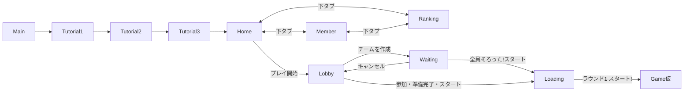

# M2b: アウトゲーム画面

M2aで作成した共通部品を使い、Main、Tutorial1〜3、Home、Lobby、Waiting、Loading、Member、Rankingを実装する。GameにはLoadingから遷移できる仮の受け口だけを置く。採集ワールド・HUD・実際のワールド生成はM3、ゲーム内パネルはM4、芋煮会演出はM5の範囲である。

## 1. 開き方

1. `D:/UnityProjects/Imoni-kai` をUnity 6000.3.21f1で開く。
2. Play Modeを終了し、`Imoni > Setup Project` を実行する。Boot、PanelSettings、FontAsset、Themeと画像・Configへの参照を更新する。
3. `Imoni > Open App` でBootを開き、Mainから再生する。すでにPlay Modeの場合はMainへ戻る。
4. Gameビューを390×844に設定する。
5. 共通部品を確認するときは `Imoni > Open Component Gallery` を使う。アプリへ戻るときは `Imoni > Open App` を実行する。
6. 自動検証は `Imoni > Validate M2b Screens` から実行する。通常のプロフィールと分けた検証専用ファイルを使用する。

Bootの通常開始画面はMain。`Bootstrap.showComponentGallery`は開発用切り替えとして残す。GalleryはEditor／Development Buildでだけ利用できる。SetupはUnity生成物をEditor APIから作るため、シーン・Prefab・metaファイルのYAML編集は不要。

## 2. 画面遷移と操作



### Main・Tutorial・Home

- MainはConfig指定の間隔と増分でローディングバーを更新し、完了後に開始ボタンを表示する。開始後はモックどおりTutorial1へ進む。
- Tutorial1は会員証部品の名前入力を使う。「登録する」で正規化・保存してTutorial2へ進む。名前の上限はConfigの10文字。空白だけの場合はConfigの初期名に戻し、保存時の切り詰めはUnicodeの文字境界を保つ。
- Tutorial2はラウンドの時間・ボーナス段階をConfigから表示する。Tutorial3はConfigの7品質と4強化を表示し、完了時にチュートリアル完了フラグを保存してHomeへ進む。
- Homeの「プレイ開始」はLobbyへ進む。Home・Member・Rankingの下タブはScreenRouterへルート名を渡し、互いに移動できる。
- Home右上の設定ボタンは音ON/OFFと閉じるボタンの設定カードを開く。音設定を保存し、AudioListenerの音量へ適用する。AudioServiceや効果音の実装はM6で行う。

### Lobby・Waiting

招待コードの受付は純C#の `Core.LobbyPresentation` に集約する。入力は前後の空白を除き、大文字にそろえる。入力欄の文字数はConfigの7文字。

| 入力／操作 | 結果 |
|---|---|
| `IMO-482` | チーム参加に成功し、メンバー・シード選択・準備完了ボタンを表示 |
| `IMO-777` | 挑戦中のチームとして参加不可のエラーを表示 |
| その他のコード（例：`IMO-999`） | チームが見つからないエラーを表示 |
| 空欄・空白だけ | 招待コードの入力を促すエラーを表示 |
| コードを編集 | 表示中のエラーを消す |
| 「準備完了」 | 自分の状態を準備OKにし、開始・準備取り消しを表示 |
| 「準備を取り消す」 | 準備中へ戻す。開始ボタンを隠す |
| 「ワールド生成してスタート」 | 準備完了後にLoadingへ進む |
| 「チームを作成」 | 自分1人からWaitingへ進む |

Waitingでは2.5秒で1人目、5.2秒で2人目のボットが参加する。参加時刻・人数・点滅間隔はConfigから読み、Coreで表示状態を決める。全員がそろうまでは開始ボタンを無効化し、そろった後に「全員そろった!スタート」でLoadingへ進む。キャンセルはLobbyへ戻し、画面の破棄で更新処理も停止する。

招待コードのコピーはクリップボードへ書き込み、完了文言を指定時間表示する。Waitingの共有ボタンはデスクトップ上の暫定動作としてチーム名とコードをクリップボードへコピーし、通知を表示する。外部サービスへの送信は行わない。

### Loading

M2bのLoadingはConfig指定時間で進む表示用の生成手順であり、実マップは生成しない。現在の設定は3秒で完了する。

| 段階 | 完了する進捗 | 完了時の補足 |
|---|---|---|
| シードを決定 | 10% | 共通シード番号または自由シード |
| 地形とバイオームを生成 | 38% | 平野・森林・河川 |
| 資源を配置 | 62% | Configの資源数（現在214か所） |
| 到達できるか確認 | 80% | 必須素材OK |
| メンバーと同期 | 100% | 3/3人 |

各行は未開始・実行中・完了の部品状態を切り替える。メンバーの同期表示は82%・90%・100%で順に完了し、ヒントは2.6秒ごとに切り替える。100%で「準備ができたよ!」と「ラウンド1 スタート!」を表示する。自動的にGameへ移動せず、開始ボタンで仮Game画面へ進む。

### Member・Ranking

- MemberCardはカード全体のタップで表裏を切り替える。初期バッジは取得済み3件と未取得3件の表示用fixture。
- 二つ名はConfigにある前半・後半6種類ずつを表示する。初期所持はそれぞれ3種類、未取得は`???`で押せない。選択変更を保存し、会員証・Home・メンバー行へ反映する。
- はちまき・服はそれぞれ4色。AvatarEditorが選択を通知し、画面側で保存する。描画は指定の4レイヤーを使う。
- Rankingは通常／エンドレス×共通／自由シードの4通りを切り替える。8行のダミーデータはConfigに置く。自分のチームは「未登録」のまま表示し、ゲーム記録の登録処理は行わない。

## 3. 画面ファイルと比較画像

UXMLは `Assets/Imoni/Resources/UI/`、controllerは `Assets/Imoni/Scripts/Game/UI/Screens/` にある。各画面はScreenViewを継承し、ScreenCatalogに登録する。タイマーはScreenViewが所有し、画面を離れると停止する。

比較画像は `docs/validation/m2b/compare_<状態名>.png` に保存した。左は元モック780×1688を390×844へ縮小した画像、右はUnity Gameビュー390×844の実撮影で、合成画像は780×844となる。下表の19状態すべてを撮影・目視確認済み。最終確認結果は6章に記録する。

| 状態名 | UXML | controller | モック画像（design/screenshots） | 比較画像（docs/validation/m2b） |
|---|---|---|---|---|
| Main_loading | Main.uxml | OnboardingScreens.cs / MainScreen | 01_Main_loading.png | compare_Main_loading.png |
| Main_ready | Main.uxml | MainScreen | 02_Main_ready.png | compare_Main_ready.png |
| Tutorial1 | Tutorial1.uxml | OnboardingScreens.cs / Tutorial1Screen | 03_Tutorial1.png | compare_Tutorial1.png |
| Tutorial2 | Tutorial2.uxml | OnboardingScreens.cs / Tutorial2Screen | 04_Tutorial2.png | compare_Tutorial2.png |
| Tutorial3 | Tutorial3.uxml | OnboardingScreens.cs / Tutorial3Screen | 05_Tutorial3.png | compare_Tutorial3.png |
| Home | Home.uxml | ProfileScreens.cs / HomeScreen | 10_Home.png | compare_Home.png |
| Lobby_choose | Lobby.uxml | LobbyScreens.cs / LobbyScreen | 11_Lobby_choose.png | compare_Lobby_choose.png |
| Lobby_join_error | Lobby.uxml | LobbyScreen | 12_Lobby_join_error.png | compare_Lobby_join_error.png |
| Lobby_team | Lobby.uxml | LobbyScreen | 13_Lobby_team.png | compare_Lobby_team.png |
| Lobby_ready | Lobby.uxml | LobbyScreen | 14_Lobby_ready.png | compare_Lobby_ready.png |
| Waiting | Waiting.uxml | LobbyScreens.cs / WaitingScreen | 15_Waiting.png | compare_Waiting.png |
| Waiting_full | Waiting.uxml | WaitingScreen | 16_Waiting_full.png | compare_Waiting_full.png |
| Loading | Loading.uxml | LobbyScreens.cs / LoadingScreen | 17_Loading.png | compare_Loading.png |
| Loading_done | Loading.uxml | LoadingScreen | 18_Loading_done.png | compare_Loading_done.png |
| Member | Member.uxml | ProfileScreens.cs / MemberScreen | 19_Member.png | compare_Member.png |
| Member_badges | Member.uxml | MemberScreen | 20_Member_badges.png | compare_Member_badges.png |
| Ranking_common | Ranking.uxml | ProfileScreens.cs / RankingScreen | 21_Ranking_common.png | compare_Ranking_common.png |
| Ranking_free | Ranking.uxml | RankingScreen | 22_Ranking_free.png | compare_Ranking_free.png |
| Ranking_endless | Ranking.uxml | RankingScreen | 23_Ranking_endless.png | compare_Ranking_endless.png |
| Game（仮） | Game.uxml | GamePlaceholderScreen.cs | M3で実装するため比較対象外 | 対象外 |

画面のレイアウトUSSは `OnboardingScreens.uss`、`ProfileScreens.uss`、`LobbyScreens.uss`。共通土台は `ScreenLayout.uss`。画面固有の配置をここに置き、部品内部の見た目は各ComponentsのUSSに残す。

開発用 `ImoniM2BReviewJob` は `Library/M2BReview.request` のJSON指定で再生中のBootを撮影し、`Library/M2B-<状態名>.png` を保存する。文字入力・クリック・セグメント変更は画面の入力ハンドラーを通す。19枚がそろったら、プロジェクトルートで次のコマンドを実行して比較画像を生成する。

```powershell
./tools/BuildM2BComparisons.ps1
```

再撮影するときはBootをPlay Modeで開き、`tools/M2BCaptureShots.json`を`Library/M2BReview.request`へコピーする。完了は`Library/M2BReview.result`の`status: complete`と19件の結果で確認する。招待参加・シードのセッション状態は撮影前に初期化し、保存プロフィールは変更しないため、表示名・二つ名・色はその端末の保存状態を反映する。

このスクリプトはUnity画像が390×844であることを確認してから左右に合成する。実行中のGameビューとモックの座標・文字・画像・選択状態を見比べる。

比較時に残す表現差は次のとおり。Homeの丸いアバターはモックの単色プレースホルダーに代わり、COMPONENTSで指定されたキャラクター4レイヤーを表示する。Memberも4レイヤーを使い、Lobby・Waiting・Loadingは同じAvatar部品のレイヤー表示を切り替えてモックと同じ塗り円にする。Memberのキャラクターと鍋・湯気・バッジの図柄は配布PNGをそのまま使うため、モック内SVGと輪郭・線幅に差がある。素材を描き直して調整しない。未取得パーツの点線はM2a／UNITY_GUIDEの実線代替を継続する。文字は指定のFontAssetを使用しており、ブラウザとUnity SDFの描画方式による太さの差は残る。湯気などのアニメーションは撮影時刻によって位置・透明度が変わる。

## 4. 部品再利用とConfig

画面UXMLには配置用VisualElementとカスタムコントロールを置く。M2aのボタン、カード、二つ名、アバター、会員証、ステータス、タブ、セグメント、品質チップ、進捗、チェックリスト、招待コード、ランキング行などを使い回す。LabelやButtonの見た目を各画面へ複製しない。Safe AreaとThemeはBootの共通ルートで扱う。

M2bで追加したカスタム部品：

| 部品 | 再利用・役割 |
|---|---|
| `ImoniText` | Themeを使う共通の文言要素 |
| `Artwork` | 素材キーから配布画像を表示する装飾要素 |
| `InputEntry` | 共通入力欄。招待コード入力に使用 |
| `TutorialTimelineStep` | Tutorial2の時刻・見出し・説明 |
| `TutorialInfo` | Cardを使ったチュートリアル説明枠 |
| `UpgradeHint` | Tutorial3の強化アイコン・名前・説明 |
| `WaitingMemberSlot` | MemberRowと待機中の枠を切り替える |
| `LoadingMember` | Avatar・名前・同期状態をまとめる |
| `RankingList` | ScrollView内に既存RankingRowを並べる。順位計算は行わない |

主なConfigキー：

| キー | 内容 |
|---|---|
| `ui.mainLoadingTickMs / mainLoadingStepPercent` | Mainのローディング間隔・増分（80ms／4%） |
| `ui.profileNameMaxLength` | 名前の上限（10文字） |
| `ui.animationFrameMs / inviteCopiedSeconds / toastSeconds` | 既存の描画更新・コピー完了表示・通知時間 |
| `outGame.lobby` | 有効／挑戦中コード、入力長、ボット参加時刻、待機点、スロット表示アニメーション、共通シード番号 |
| `outGame.loading` | 完了時間、段階閾値、同期閾値、ヒント切り替え間隔、表示用資源数 |
| `outGame.profile` | 初期名・会員番号・最高到達・初期所持パーツ・バッジfixture・許可色と初期色 |
| `outGame.ranking` | 4部門のダミー順位、チーム名、スコア、到達ラウンド、日付、シード |
| `titles / qualities / upgrades / round / team` | M1から継続する二つ名・品質・強化・ラウンド条件・人数 |

ランキングfixtureは整数の`score`とモックに一致する`displayScore`を併記する。M2bのダミー表示では後者を使用し、M1で確定した `Format.Big()` の小数形式は変更しない。実記録の集計・ランキング登録は後続マイルストーンで接続する。UI寸法と色はモック／Themeに基づき、動作時間や判定用の数値はConfigから読む。

## 5. プロフィールの保存と検証データ

保存データは `Core.ProfileData`。名前、前半・後半の二つ名、はちまき・服の色、音ON/OFF、チュートリアル完了を保持する。`Core.ProfilePersistence` が初期化・入力制約・JSON変換を担当し、ScreenContextがファイルを読み書きする。

通常の保存先は `Application.persistentDataPath/imoni-profile.json`。一時ファイルへ書いてから置き換える。破損JSONや未作成ファイルはConfigの初期値から読み直し、未所持の二つ名・許可外の色は保存時に初期値へ正規化する。

名前はTutorial1の登録時、二つ名と色は選択変更時、音設定は切り替え時に保存する。画面を行き来したときだけでなく、Play Modeを終了して起動し直したときも保存内容を再読み込みする。チュートリアル完了フラグは保存するが、Mainの開始ボタンからの順番はモックと同じTutorial1開始としている。

自動検証はScreenContextの保存先引数へ**検証専用ファイル** `Library/M2B-validation-profile.json` を渡し、通常の`imoni-profile.json`を上書きしない。保存・再読込の実行結果は6章へ記入する。

## 6. 最終検証記録

2026-11-25、Unity 6000.3.21f1／Gameビュー390×844で確認。M2bの対象画面とM2aレビュー修正を完了し、M3には進んでいない。

| 確認 | 結果 |
|---|---|
| Unity再コンパイル・USS/UXMLインポート | 成功。エラー0・警告0 |
| Setup Project・Open App・Bootの390×844表示 | 成功。実Gameビューで確認 |
| Main→Tutorial1〜3→Home→Lobby→Waiting→Loading→Game仮 | 7本の自動フロー検証が全成功。実入力でもMainからHome、Lobby経由Loading→Game仮まで確認 |
| 招待コード4結果、準備完了と取り消し、キャンセル | 自動検証で全成功。実クリックでもIMO-777エラー→IMO-482参加→準備完了→Loading→Game仮を確認 |
| Memberの表裏・二つ名・色、Home反映、Rankingの4通り | 自動検証成功。実操作で表裏、「山の」＋「薪割り職人」、緑はちまき・茶色の服、Home反映、Rankingの共通→自由・エンドレスを確認 |
| 保存・再読込、音設定、検証専用ファイルの分離 | 成功。自動検証は`Library/M2B-validation-profile.json`のみを使用。実操作でも音OFFとプロフィールの変更後、Play Modeを完全終了・再起動して全項目の保持を確認 |
| モック比較19枚の生成と目視確認 | 全19状態を再撮影・目視確認。全画像780×844（左右各390×844）、主要配置・文言・状態表示の崩れなし。画像素材・SDF・アニメ位相の差は3章に明記 |
| `dotnet test tools/CoreTests` | **合計142件、成功142件、失敗0件、スキップ0件**。[TRX](validation/m2b/dotnet-test.trx) |
| 禁止USS構文、UXMLの部品再利用チェック | 禁止構文検索は該当なし。Game仮を含む11ルートのUXML構成・CloneTree検証が全成功 |
| Theme・部品USSの共有 | 実ツリーで共有スタイルシート10枚、部品自身の重複0枚、単独使用時のフォールバック2枚を確認 |
| M2a ComponentGallery回帰 | 35部品・全バリエーションを46枚で撮影保存。disabled専用色・実線・影なしと配置背景を目視確認。撮影完了時もConsoleエラー0・警告0。[撮影一覧](validation/m2a/captures.json) |

自動検証の詳細は [validation.json](validation/m2b/validation.json)。非表示の一時ツリーで入力欄・イベントを接続し、Waiting／Loadingの完了状態はCoreの表示モデルで検証する。実時間の描画・ポインター操作・保存の確認はこれと別に実Gameビューで実施した。チーム作成ボタンからWaitingへ入り、1人から3人に増え、開始ボタンが有効になることも実時間で確認した。

保存を確認した画面は [persistence_Home.png](validation/m2b/persistence_Home.png) と [persistence_Member.png](validation/m2b/persistence_Member.png)。通常の保存ファイルは検証前には存在していなかったため、実操作で作ったテスト保存はLibraryへ退避し、通常の保存先を初期状態へ戻した。自動検証も通常の保存ファイルを変更していない。

Play Mode中の再コンパイル後に入力が反応しない状態が一度発生したが、Play Modeを停止して再開すると解消した。入力設定は変更していない。以後の画面操作・永続化確認は完全に再開したPlay Modeで行った。

追加テストは `ProfilePersistenceTests` の7件と `LobbyPresentationTests` の11件、計18件。前者は未作成／空／破損保存、全編集項目の再読込、Unicodeを含む名前制限、未所持パーツ・不正色、空白名を確認する。後者はコード正規化と4結果、Configからのコード変更、ボット参加の時刻境界、各Loading段階・同期の閾値、ヒント間隔、不正設定・入力に加え、ラウンド時間・必要成功数・ボーナス閾値を変更したときの説明文を確認する。既存M1・M2aの124件も継続して成功した。
