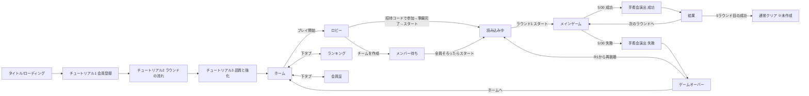

# 画面仕様（UI_SPEC）

- **正解の見た目**：`mock/*.dc.html`（ブラウザで動くモック）と、`design/screenshots/*.png`（390×844 の2倍解像度）。
- **寸法の単位**：すべて px（基準 390×844）。色は `design/tokens.json` と `Theme.uss` の変数名で書く。
- **迷ったとき**：モックの HTML を開き、`style="..."` の数値をそのまま USS に移す。

## 0. 画面遷移

**画面の作り方**
- 1画面 = 1つの UXML（`Assets/Imoni/Resources/UI/<Name>.uxml`）。`ScreenRouter.Show("<Name>")` で切り替える。
- メインゲームだけは、ワールド（シーン）の上に HUD 用の UXML を重ねる。
- 倉庫・ショップ・強化・メニューのパネルは、HUD 内の別 UXML として出し入れする。

## 共通ルール
- 背景は `--c-yellow`。濃い茶色の枠線（3〜4px）と大きめの角丸（16〜26px）が基本。
- 見出し・大ボタン・大きい数字は **Dela Gothic One**、それ以外は **Zen Maru Gothic**（500/700/900）。
- 押せるものは高さ 44px 以上。押すと 3px 下に沈む（`.btn:active`）。
- 下タブ（ホーム／ランキング／会員証）は高さ 76px。選択中のタブは黄色背景にする。
- 画面の上端は 52px あける（ノッチ対策。実機では `Screen.safeArea` に合わせる）。

---

## 1. タイトル / ローディング（Main）
スクリーンショット：`01_Main_loading.png`, `02_Main_ready.png`
- **背景**：黄色地に里芋柄（`Art/Backgrounds/imoni_tile_*.png` を 96×104 で繰り返す）。
- **ロゴ**：上から 170px の位置。「みんなで」（Dela 30px・えんじ）、その下に「芋煮会」（Dela 80px・えんじ・クリーム色の影 4px）。右側の湯気は表示しない（M8実機レビュー）。
  - `TitleLogo` が既存画像の文字部分だけを表示する。原画の文字・影は変更せず、分離した右側の湯気をクリップする。
  - ロゴの下にキャッチコピー「リモートでつながる、秋の鍋あそび」（15px）。
- **進捗バー**：下から 96px、左右 32px。
  - 高さ 18px、クリーム地、茶枠 3px、中身は若草色。
  - 約2秒で 0→100% になる（本番は実際の読み込みに連動）。
- **完了後**：「タップしてはじめる」ボタン（深緑・高さ44px）→ 初回はTutorial1、登録済みはHome。会員ログイン画面は挟まない。
- 右上の設定ボタンはHomeと共通のSettingsDialogを開く。BGM/効果音を別々に保存し、アカウント切り替えもこの中に置く。

## 2. チュートリアル 1/3 会員登録（Tutorial1）
スクリーンショット：`03_Tutorial1.png`
- **見出し**：「会員登録しよう!」（Dela 30px・深緑）＋「(1/3)」（えんじ）。
- **会員証カード**（クリーム・茶枠4px・角丸22・下に影6px）
  - ヘッダー：焦げ茶地に「リモート芋煮会 会員証 / MEMBER」。
  - 左：写真ボタン（104×128・水色グレー・カメラアイコン）。
  - 右：
    - 二つ名ラベル（前半＝深緑、後半＝えんじ）
    - 名前の入力欄（最大10文字・初期値「ゆくらさん」）
    - 会員番号
- **説明枠**（点線）：「二つ名は前半と後半を集めて組み合わせ!」と説明文。
- **下部**：ページ送りの点（1つ目が横長の深緑）と「登録する」大ボタン → Tutorial2。

## 3. チュートリアル 2/3 ラウンドの流れ（Tutorial2）
スクリーンショット：`04_Tutorial2.png`
- **タイムライン**：3行。
  - 0:00 必須素材の発表
  - 2:00 ボーナス素材の発表（「目標の100%で報酬。150%・200%・300%でさらに倍!」）
  - 5:00 芋煮会!
- **成功／失敗の説明**：2列のカード。
- **クリア条件**：「5ラウンド連続成功でクリア!」。
- **下部**：「次へ」→ Tutorial3。

## 4. チュートリアル 3/3 品質と強化（Tutorial3）
スクリーンショット：`05_Tutorial3.png`
- **品質チップ**：7つ。伝説までは名前・倍率・品質色を表示。神話・超越・究極はグレーの「???」、倍率は非表示（M8）。
- **連続ボーナスの説明カード**：マスコット画像（`Sprites/Game/mascot.png`）付き。
- **強化4項目**：2×2で並べる。
- **締め**：「ねばれ、きばれ、がんばれ!」。
- **下部**：「はじめる」→ Home。

## 5. ホーム（Home）
スクリーンショット：`10_Home.png`
- **上部**：アバター丸、二つ名チップ、名前、設定ボタン（44×44）。
- **中央カード**：大きなカードに鍋とたき火の絵（`pot_campfire.png`）、「みんなで芋煮会」、チーム名。
- **記録**：3つの小カード。
  - 最高到達 R3
  - 通常クリア 未達成
  - ランキング 未登録（**失敗した挑戦は登録されない**）
- **ボタン**：「▶ プレイ開始」大ボタン → Lobby。
- **モード表示**：「通常モード」チップと「エンドレス:5連続成功で解放」チップ。
- **下タブ**：ホームが選択中。

## 6. ロビー（Lobby）
スクリーンショット：`11_Lobby_choose.png`, `12_Lobby_join_error.png`, `13_Lobby_team.png`, `14_Lobby_ready.png`

**選択画面**
- 「チームを作る」カード：「チームを作成」→ Waiting。
- 「招待コードで参加」カード：
  - 入力欄（`IMO-000` 形式、大文字にする）と「参加する」。
  - エラー表示：
    - 空欄：「招待コードを入力してください」
    - 挑戦中のチーム：「このチームは挑戦中のため参加できません…」（仕様 11.4）
    - 存在しない：「チームが見つかりません」
  - モック用のコードは `IMO-482` で参加成功、`IMO-777` で挑戦中エラー。

**チーム画面**
- チーム名と招待コード（焦げ茶の帯）。
- メンバー3行（アバター・二つ名・名前・準備OK/準備中バッジ）と「招待コードをコピー」。
- モード・シード選択：「共通シード（今週 #2026-47・共通シード部門）」／「自由シード（ランダム生成・自由シード部門）」。
  - どちらもランキング対象で、部門が別。
- 「準備完了」→ 押すと「ワールド生成してスタート」（えんじ大ボタン）→ Loading。「準備を取り消す」もある。

## 7. メンバー待ち（Waiting）
スクリーンショット：`15_Waiting.png`, `16_Waiting_full.png`
- **上部**：「キャンセル」（→ Lobby）、シードチップ。
- **見出し**：揺れる鍋＋湯気、「メンバーを待っています」と「チームは3人で挑戦するよ」。
- **招待コード**：焦げ茶カードに大きく `IMO-482`（Dela 44px・黄色・字間6px）、「コードをコピー」（押すと1.6秒間「コピーしました!」）と「共有する」。
- **メンバー枠3つ**
  - 埋まった枠はポンと拡大して出る（0.45秒）。
  - 空き枠は点線で、輪が脈打つアニメーション。「参加を待っています…」の「…」は 0.5秒ごとに変わる。
- **下部ボタン**
  - そろうまで：押せないボタン「あと○人そろうとスタートできます」。
  - 3/3 になったら：「全員そろった!スタート」（えんじ）→ Loading。
- **モックの再現**：2.5秒後に1人、5.2秒後にもう1人が参加する。

## 8. 読み込み中・ワールド生成（Loading）
スクリーンショット：`17_Loading.png`, `18_Loading_done.png`
- **背景・見出し**：里芋柄の背景、揺れる鍋（湯気3本）、「ワールドを生成中…」（Dela 28px・えんじ・クリームの影）、チーム名とシード。
- **進み具合カード**：5ステップ。各ステップの印は「完了＝深緑丸のチェック／処理中＝回転リング／未着手＝点線丸」。
  1. シードを決定
  2. 地形とバイオームを生成
  3. 資源を配置
  4. 到達できるか確認
  5. メンバーと同期

  その下に進捗バーと「%」。**本番は実際のワールド生成・同期の進み具合に連動させる。**
- **メンバー**：3人のアイコンに「読込中 → OK」の表示。
- **ヒント**：2.6秒ごとに切り替わる。
- **完了時**：「準備ができたよ!」と「ラウンド1 スタート!」→ Game。

## 9. 会員証（Member）
スクリーンショット：`19_Member.png`, `20_Member_badges.png`
- **会員証カード**：タップで表と裏が切り替わる。
  - 表：写真、二つ名、名前、チーム・最高到達、No.
  - 裏：「達成したバッジ n/6」、3×2 のバッジ。未取得は「???」で薄い色。
- **二つ名をくみあわせる**
  - 前半6つ・後半6つのチップ。選択中は塗りつぶし（前半＝深緑、後半＝えんじ）。未入手は点線で「???」、押せない。
  - 右上に「前半 3/6 / 後半 3/6 収集」。
- **自分のキャラの編集**
  - キャラ画像は4枚のレイヤーを重ねる（`avatar_1_outfit_white` → `avatar_2_base` → `avatar_3_band_white` → `avatar_4_band_line`）。白いレイヤーを `style.unityBackgroundImageTintColor` で着色する。
  - はちまき4色（#8B2310 / #34421C / #2F5D8A / #FFFFFF）、服4色（#FFF3D6 / #6B9B3A / #C9A27A / #8FAFC4）。44px の丸い色ボタンで、選択中は二重の輪。
- **下タブ**：会員証が選択中。

## 10. ランキング（Ranking）
スクリーンショット：`21_Ranking_common.png`, `22_Ranking_free.png`, `23_Ranking_endless.png`
- **切り替え**：
  - モード：「通常モード／エンドレス」（丸いセグメント）。
  - 部門：「共通シード／自由シード」（角丸タブ）。
  - 説明行：「共通シード部門:今週 #2026-47」または「自由シード部門:マップはチームごとにランダム」。右に「3人部門」。
- **一覧の各行**：順位（1位えんじ、2〜3位茶）、チーム名、補足行、スコア（Dela）。
  - 補足行：「5R連続成功 · シード#xxxxx（自由シードのみ）· 日時」。
  - スコアは「12億3,456万」のように **万・億・兆** の単位で表示する（`Format.Big()` を作る）。
- **自分のチーム**：最下部の深緑の帯に「未登録」と「5ラウンド連続成功で登録されます（最高 R3）」。

## 11. メインゲーム（Game）
スクリーンショット：`30_Game_start.png`, `31_Game_collecting.png`, `32_Game_shop.png`, `33_GameMid_bonus.png`, `34_GameMid_menu.png`, `35_GameWarehouse.png`, `36_GameUpgrade.png`, `37_Game_timeup.png`

**HUD（上部 200px・黄色・下に茶の線）**
- **1行目**：
  - 「ラウンド 1/5」（焦げ茶の丸ラベル）
  - 残り時間（Dela 34px。残り30秒以下はえんじ）
  - 共有資金（コインアイコン＋「1,000G」、クリームの丸ラベル）
- **2行目（必須素材）**：縦書きの「必須」ラベル＋3枚の素材チップ。
  - 各チップ：素材名、現在/必要（**品質換算数量**）、細い進捗バー。
  - 達成したチップは深緑地・クリーム文字になる。
- **3行目（ボーナス）**：「ボーナス」ラベル。
  - 2:00 までは「あと m:ss で発表!」。
  - 発表後は「キノコ 現在/目標」と「達成率 n% 報酬×T」（T は 0/1/2/4/8）。

**マップ（HUD と下ボタンの間、高さ 560px）**
- **作り方**：Tilemap と Sprite で描く。
  - タイル：`Sprites/Tiles/tile_*.png`（平野・森・川・橋・畑・未開放の重ね）。
  - 資源：`Sprites/Game/resource_*.png`（48×48 のタップ領域）。
- **未開放エリア**：グレーで覆い、鍵アイコンと「R2で探索範囲が拡大」。
- **資源をタップしたとき**
  1. キャラがその資源の下まで歩く（直線ではなく A* で障害物を避ける）。
  2. 着いたら資源の上に採集バーが出る。
  3. 1.6秒ごとに1回採集する。
  4. 在庫3回分を取り切ると切り株になり、「成長中 n秒」と表示する。
- **採集したとき**：キャラの上に「+3 薪(良質) 連続4」のポップアップが1.3秒出る。色は品質ラベルと同じ。
- **左上**：「最高品質 連続 n ×M」（焦げ茶の丸ラベル）。
- **チームメイト**：小さいキャラ＋「たろう 採集中」の名札。切断中は半透明で「切断中」。
- **下部トースト**：最新の履歴を約2.2秒表示する。パネルを開いている間は出さない。

**下ボタン（高さ 84px）**
- 「倉庫／ショップ／強化／メニュー」の4つ（アイコン＋文字）。
- 押すと対応するパネルが下から出る。開いているボタンは深緑。

**倉庫パネル（高さ 620px）**
- **ヘッダー**：「共有倉庫」、資金、閉じるボタン。
- **一覧**：列は「素材(品質チップ)／所持／保護／売却可／単価」。行をタップすると選択できる。
- **選択中の行の操作**
  - 保護：「−」「＋」は5ずつ増減、「全部保護」と「保護解除」で切り替え。
  - 売却数：25%・50%・75%・100% ボタン（売却可能数が基準）と数量入力欄。
  - 「n個 売却 +xG」ボタン（えんじ）。**確認画面なしで即売却**（仕様 7.4）。
- **全体の操作**：「保護以外をまとめて売却」。
- **操作履歴**：直近3件、時刻付き。

**ショップパネル（高さ 540px）**
- 素材4種について、「×10」「×50」の購入ボタン（価格付き。資金が足りないときは押せない）。
- 購入品は「普通」品質。

**強化パネル（高さ 560px）**
- 4項目それぞれに、「名前 Lv.n」「現在の効果 → 次の効果」「強化 価格G」ボタン（資金不足なら押せない）。
- 説明文：「強化は自分だけに効果。資金はチーム共通」。

**メニューパネル（高さ 440px）**
- メンバー一覧：接続状態の点（緑／灰）と、状態（待機中・採集中・切断中・再接続待ち）。
- 「ホームへ戻る（挑戦は中断）」。

**5:00 になったとき**
- 操作を止め、半透明の焦げ茶で画面を覆う。
- 黄色カードに「5:00 タイムアップ」「芋煮会の時間だ!」「倉庫の素材をすべて鍋に投入したよ」「結果を見る」。
- 「結果を見る」の行き先：成功なら Imoni（演出）、失敗なら ImoniFail。

## 12. 芋煮会演出（Imoni / ImoniFail）★重要
スクリーンショット：`40_Imoni_start.png`, `41_Imoni_mid.png`, `42_Imoni_finale.png`, `44_ImoniFail_mid.png`, `45_ImoniFail_end.png`

**実装は `docs/IMONI_EFFECT_SPEC.md`（画面座標の式・素材・重ね順）に従う。** 参考動画は `design/videos/`。数値は `GameConfig.imoniEffect`。

### 長さ
**合計10秒以内**。
- 0〜0.5秒：光の柱が伸びる。
- 0.5〜6.8秒：食材が落ちる。
- 最後の食材が着地したら完成演出。
- 8.2秒で強制的に完成させる（重い端末対策）。
- 完成から1.0秒後（失敗は1.3秒後）に「結果を見る」を出す。

### 画面の重なり（下から順に）
1. **虹色の背景**：縦方向のグラデーションを上へ流す。レベルが上がるほど速くなる。
2. **放射状の光**：鍋の中心から出て回転する。Lv.1 から出て、レベルが上がるほど濃くなる。
3. **白い光のライン**：上から下へ高速で流れる。本数と速さはレベルで増える。
4. **光の柱と虹色のにじみ**：中央の白い柱。太さは 56 + 16×Lv。
5. **キラキラ**：4点星。柱の左右で点滅しながら漂う。
6. **食材**：里芋・ねぎ・キノコ・牛肉・こんにゃく（`Sprites/Game/ingredient_*.png`）。上から回転しながら落ち、柱の中心に寄りながら小さくなり、鍋に吸い込まれる。
7. **鍋**：`pot_effect.png`。上端は y≈520、汁の位置は y≈556。食材が入るたびに1.06倍に弾む。
8. **星・光の輪**：食材が入るたびに小さい星が5〜9個上にはじける。レベルアップでは大きい輪と14個の星が広がる。
9. **HUD（上）**：「音あり/タップで音ON」ボタン、「スキップ」、芋煮スコアのカード。
   - カードの中身：「Lv.n レベル名」、スコア（Dela 40px・カウントアップ）、虹色のゲージ。

### レベル
- スコアが最終値の 5.4% / 16.3% / 32.6% / 54.3% / 81.4% を超えるたびに Lv.1〜5 に上がる。
- 名前は「ことこと… / いい匂い! / ぐつぐつ! / 大成功の予感! / 伝説の芋煮!! / 天下一の芋煮!!!」。
- **レベルアップの瞬間**
  - 白いフラッシュ（0.38秒）と画面の揺れ（0.42秒）。
  - 「LEVEL UP! ＋レベル名」が −6度傾いて飛び出す。
- **Lv.3 以上**：食材が2個同時に落ちることがある。着地のたびに小さく揺れる。

### 成功の最後
- フラッシュ、柱が太くなる、「大成功!! 芋煮 完成!!」（拡大して出る）。
- 「結果を見る」「もう一回見る」を出す。

### 失敗（ImoniFail）
- Lv.3 までしか上がらない。
- 最後は次の流れにする。
  1. 画面全体を0.7秒かけて灰色にし、暗くする。
  2. 柱がチラついてしぼむ。
  3. 「あれ…? 芋煮 未完成…」が上から落ちてくる。
  4. `必須素材「魚」が足りなかった` と表示する（実際に不足した素材名を入れる）。
  5. 「結果を見る」→ GameOver。

### 音（`Assets/Imoni/Audio/SFX`）
| タイミング | ファイル | 使い方 |
|---|---|---|
| 演出開始 0.3秒〜完成まで | `bgm_drone_loop.wav` | ループ再生。レベルごとに pitch = 2^(2×Lv/12)、ローパスを開く（AudioLowPassFilter 260+260×Lv Hz）。完成時に0.6〜1.2秒でフェードアウト |
| ビート | `sfx_beat.wav`（Lv.0〜1）/ `sfx_beat_hihat.wav`（Lv.2〜） | 間隔は `beatIntervalMs[Lv]` |
| 食材が入る | `sfx_hit.wav` | pitch = 2^((2×Lv + PENTA[step%5] + 12×floor(step/5)) / 12)。PENTA=[0,2,4,7,9]、step はそのレベルで入った数（最大9）。レベルが上がると step を0に戻す |
| レベルアップ | `sfx_levelup_L1..L5.wav` | そのレベルのファイルを鳴らす |
| 成功の最後 | `sfx_finale_success.wav` | |
| 失敗の最後 | `sfx_finale_fail.wav` | |

- AudioMixer に Master グループを作り、軽いコンプレッサーをかける。
- 音のON/OFFは画面左上のボタンで切り替え、設定に保存する。

## 13. 結果（Result）
スクリーンショット：`43_Result.png`
- **上部**：「ラウンド 1/5 結果」、「芋煮会 成功!」、ランクの丸（えんじ・Dela 40px）と「うまい芋煮ができた!」。
- **必須素材**：素材ごとのバーと「128/60」。
- **ボーナス**：「キノコ 48/30」「160% 報酬×2」と、100%/150%/200%/300% の段階チップ（到達した段階は塗る）。
- **スコア内訳**：素材ポイント R（→ 0.5R）、ボーナスポイント B × T（→ 0.5BT）。注記「売却した素材はスコアに含まれません」。
- **焦げ茶カード**：獲得スコア、獲得資金（+1,200G）、累積スコア、新しい二つ名パーツ（例「連続の」GET!）。
- **下部**：「次のラウンド:探索範囲が拡大!資金と強化は引き継ぎ、素材はリセット」と「ラウンド2へ」。

## 14. ゲームオーバー（GameOver）
スクリーンショット：`46_GameOver.png`
- **背景**：焦げ茶。
- **見出し**：「ラウンド 3/5 結果」「芋煮会 失敗…」（Dela 34px・黄色）。
- **必須素材**：足りなかった素材はえんじのバーで「不足」と表示する。
- **リセットされるもの**（黄色の点線枠）：
  - 素材と資金
  - 個人強化と連続記録
  - マップ
  - 「今回の挑戦はランキングに登録されません」
  - 「過去のランキング記録・会員証・二つ名はそのまま」
- **記録**：今回の到達ラウンド、累積スコア（参考）。
- **ボタン**：「R1から再挑戦」（黄色）→ Loading、「ホームへ戻る」。

## 15. まだ作っていない画面（仕様にはある）
通常クリア画面、エンドレス移行、設定、ログイン、再接続中の画面。
既存画面と同じスタイルで作ってよい。迷ったら `docs/QUESTIONS.md` に書いて先へ進む。

## 16. 遊び方（Help）★追加
スクリーンショット：`50_Help_1_controls.png` 〜 `54_Help_5_score.png`、モック：`mock/Help.dc.html`（`?section=0〜4` で各項目）
- **入り口**：ホーム右上の「?」ボタン（設定ボタンの左、同じ44pxの角丸枠）と、ゲーム中のメニューパネルの「遊び方を見る」（深緑のボタン。「ホームへ戻る」の上）。設定画面にも「遊び方」の行を置く。
- **上部**：「< 戻る」（開いた画面へ戻る）と見出し「遊び方」（Dela 26px・深緑）。
- **項目タブ**：5つを横一列に並べる（操作・流れ・倉庫・強化・スコア）。高さ56px、アイコン＋文字。選択中は深緑地・クリーム文字。`SegmentedControl` を拡張するか、新しい部品 `HelpTabs` にする。
- **本文カード**：焦げ茶の見出し帯に「1. 基本の操作」と「1 / 5」を表示する。その下に導入文1行と、番号付きの手順3〜4個を並べる。
  - 各手順：52pxの色付き角丸アイコン（左上に黄色い番号丸）＋見出し（15px・900）＋説明（13px）。
  - 内容が多いときは、カードの中だけがスクロールする。
  - 「強化」の項目では、品質チップ（普通〜伝説、上位3つは「???」）を表示する。
  - 注意書きは、薄赤の地にえんじ文字の小さなラベルにする。
- **下部**：「‹ 前へ」（枠線。最初の項目では押せない）と「次へ ›」（深緑）。最後の項目では「わかった!」で元の画面へ戻る。
- **文言**：`mock/Help.dc.html` の `SECTIONS` が正。文言の調整はこの配列だけを直せば済むように、`GameConfig` か別の JSON（`Config/HelpContent.json`）に持たせる。

## 17. BGM ★M9で改訂
### ゲーム中（メインゲーム画面）＝オーナー指定の曲
- `Assets/Imoni/Audio/BGM/bgm_game_main.wav`（152BPM・約78.2秒・44.1kHz ステレオ）。**これが正式なゲーム中BGM**。
- 再生方法：**最初だけイントロ（0〜12.634秒）を流し、そのあとはループ区間（12.634秒〜最後）を繰り返す**。
  - ループ位置は `bgm_game_main_loop.json`（loopStartSample=557149 / loopEndSample=3446763 / sampleRate=44100）。値は GameConfig（例 `audio.gameMain.loopStartSample`）にも持たせ、コードに直書きしない。
  - 推奨実装：分割済みの `bgm_game_main_intro.wav`（イントロだけ）と `bgm_game_main_loop.wav`（ループ区間だけ・loop=true）を AudioSource 2つで `PlayScheduled` を使って継ぎ目なくつなぐ（イントロ終了時刻 = dspTime + イントロ長）。
  - 代替実装：`bgm_game_main.wav` 1本を再生し、`timeSamples >= loopEndSample` で `loopStartSample` に戻す方式でもよい（ただし Update 依存でズレやすいので推奨は上）。
  - インポート設定：Load Type = Streaming か Compressed In Memory、**Preload Audio Data ON**、圧縮は Vorbis 品質70前後。ループ用は「Gapless」相当になるよう Decompress On Load も可。
- 旧仮曲 `bgm_game_loop*.wav`（和風・バンド・7/8）は**使わない**（入れてあっても参照しない。削除してよい）。
### ゲーム外（タイトル・ホーム・ロビー・メンバー待ち・会員証・ランキング・遊び方）
- `bgm_home_loop.wav`（和風・92BPM・約62.6秒）／ `bgm_home_loop_band.wav`（バンド版・同じ長さ）。
- どちらを使うかは GameConfig `audio.bgmStyle = "wa" | "band"`（初期値 "wa"）。loop=true でそのまま継ぎ目なく回る。
### 共通
- 画面切り替えでは0.5秒クロスフェード。ゲーム中→ゲーム中（ラウンド間）は止めずに続ける。
- 芋煮会演出（Imoni / ImoniFail）の間はBGMを0.3秒でフェードアウトして止め、結果画面（Result / GameOver）では home 側の曲を流す。次ラウンド開始でゲーム中の曲をイントロから再生する。
- 音量は設定の「BGM」に従う（効果音とは別のミキサーグループ）。アプリがバックグラウンドに行ったら一時停止、戻ったら再開。
- 全部ファイル名で参照し、後から差し替えられるようにする（AudioCatalog / ScriptableObject などで一元管理）。
